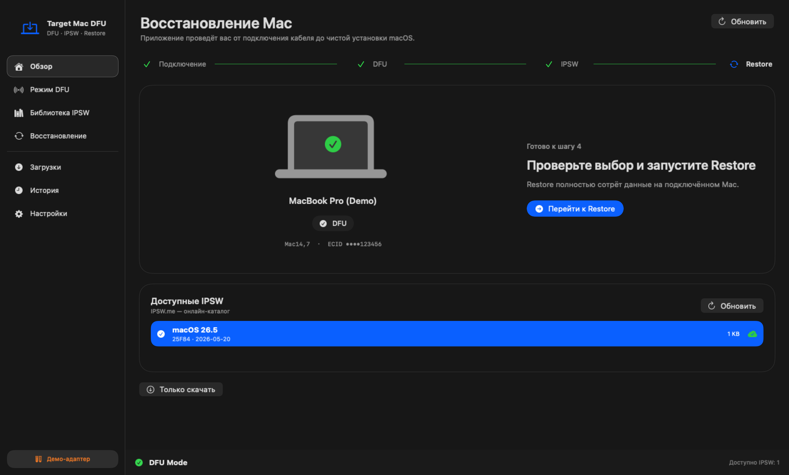
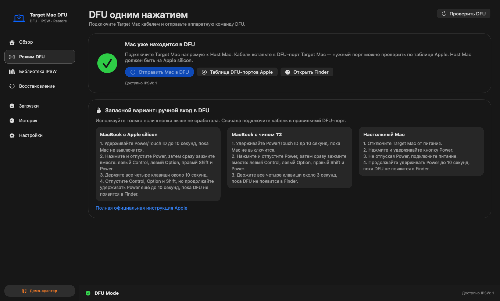
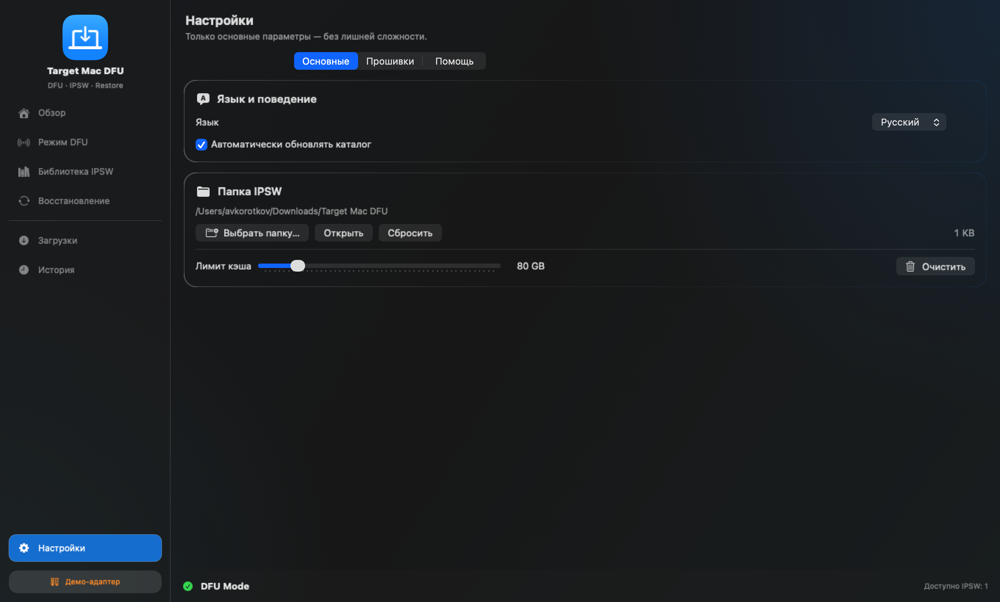

# Target Mac DFU

[Русский](README.md) · [Download](https://github.com/Sampsih/target-mac-dfu/releases/latest) · [Changelog](CHANGELOG.md)

Target Mac DFU helps you restore a Mac that won't start. Run the app on a second Mac, put the connected Mac into DFU mode, and choose an IPSW firmware file. The app downloads the file if needed and checks it before restoring the Mac.



## What you need

- An Apple silicon host Mac running macOS 14 or later.
- A target Mac with Apple silicon or an Apple T2 chip.
- A USB-C cable that supports data and charging. Connect it directly to the target Mac's [DFU port](https://support.apple.com/120694). Avoid Thunderbolt 3 cables.
- Apple Configurator with Automation Tools for Restore. The current Mac App Store version requires macOS 15.7 or later. Setting up one-click DFU may require Xcode Command Line Tools.

## Quick start

1. Download and unzip the app, then move it to **Applications**. If prompted, install Apple Configurator and Automation Tools.
2. Connect the two Macs. Open **DFU Mode** and click **Send Mac to DFU**. If the button doesn't work, follow the manual steps on the same screen.
3. Check the model and ECID, select an IPSW, and click **Continue to Restore**.
4. Review the readiness checks, click **Start Restore**, and confirm. Leave the cable and power connected until the restore finishes.

> [!CAUTION]
> Restore erases all data on the target Mac. Check which Mac is connected and make sure you have a backup before proceeding.

You can download firmware separately, pause and resume downloads, choose where to store files, and add beta firmware or a custom catalog. Try demo mode to explore the app without a second Mac.

<details>
<summary>More screenshots</summary>





</details>

## Documentation

[Installation](docs/INSTALLATION.md) · [User guide](docs/USER_GUIDE.md) · [Troubleshooting](docs/TROUBLESHOOTING.md) (in Russian) · [Custom IPSW catalogs](docs/CUSTOM_CATALOG.en.md)

To build from source, run `./scripts/build.sh`. [Contributing](CONTRIBUTING.md) · [MIT license](LICENSE)

## Support the project

[Buy Me a Coffee](https://buymeacoffee.com/sampsih) · [CloudTips](https://pay.cloudtips.ru/p/56c624cb) · [TON](https://tonviewer.com/UQBDpkQH_ryzYKm5iiBQLuFz32SJllk4WI3drZfjQCYFHKX4)

TON mainnet address:

```text
UQBDpkQH_ryzYKm5iiBQLuFz32SJllk4WI3drZfjQCYFHKX4
```
