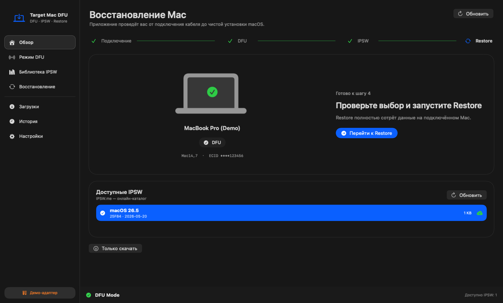
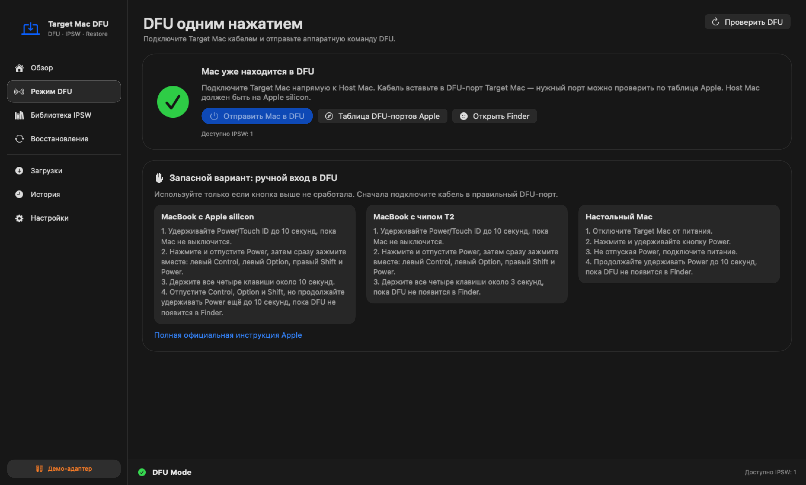
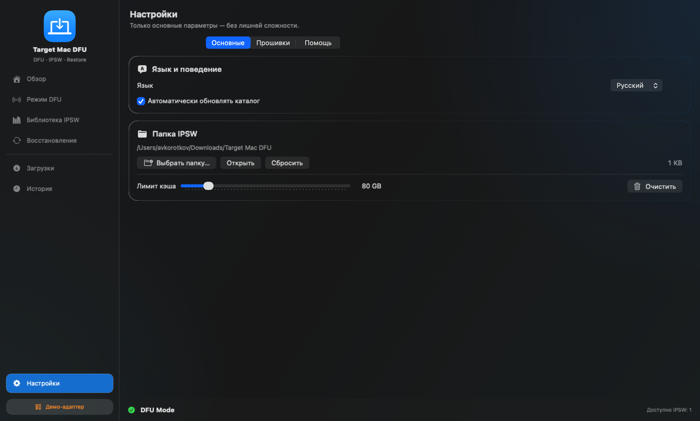

# Target Mac DFU

[English](README.en.md) · [Скачать приложение](https://github.com/Sampsih/target-mac-dfu/releases/latest) · [Журнал изменений](CHANGELOG.md)

Target Mac DFU помогает восстановить Mac, который перестал загружаться. Запустите приложение на втором Mac, переведите подключённый компьютер в DFU и выберите прошивку IPSW. Приложение скачает её при необходимости и проверит перед восстановлением.



## Что понадобится

- Рабочий Mac с Apple silicon и macOS 14 или новее.
- Восстанавливаемый Mac с Apple silicon или чипом T2.
- Кабель USB-C с передачей данных и зарядкой. Подключайте его напрямую к [DFU-порту](https://support.apple.com/120694). Кабель Thunderbolt 3 для этой операции не подходит.
- Apple Configurator с Automation Tools для Restore. Версия из Mac App Store требует macOS 15.7 или новее. Для автоматического входа в DFU могут понадобиться Xcode Command Line Tools.

## Как пользоваться

1. Скачайте ZIP, распакуйте его и перенесите приложение в папку **Программы**. Если приложение попросит, установите Apple Configurator и Automation Tools.
2. Соедините два Mac. В разделе **Режим DFU** нажмите **Отправить Mac в DFU**. Если кнопка не сработает, в этом же разделе есть ручная инструкция.
3. Сверьте модель и ECID, выберите IPSW и нажмите **Перейти к Restore**.
4. Проверьте готовность, нажмите **Запустить Restore** и подтвердите операцию. Дождитесь завершения, оставив питание и кабель подключёнными.

> [!CAUTION]
> Restore стирает все данные на восстанавливаемом Mac. Перед запуском проверьте, какой Mac подключён, и убедитесь, что у вас есть резервная копия.

Прошивку можно скачать отдельно, поставить загрузку на паузу и продолжить позже. В настройках можно выбрать папку, включить бета-версии или подключить свой каталог. Демо-режим позволяет посмотреть приложение без второго Mac.

<details>
<summary>Ещё скриншоты</summary>





</details>

## Документация

[Установка](docs/INSTALLATION.md) · [Руководство](docs/USER_GUIDE.md) · [Решение проблем](docs/TROUBLESHOOTING.md) · [Свой каталог IPSW](docs/CUSTOM_CATALOG.md)

Для сборки из исходников запустите `./scripts/build.sh`. [Как внести изменения](CONTRIBUTING.md) · [Лицензия MIT](LICENSE)

## Поддержать проект

[Buy Me a Coffee](https://buymeacoffee.com/sampsih) · [CloudTips](https://pay.cloudtips.ru/p/56c624cb) · [TON](https://tonviewer.com/UQBDpkQH_ryzYKm5iiBQLuFz32SJllk4WI3drZfjQCYFHKX4)

Адрес для перевода в сети TON:

```text
UQBDpkQH_ryzYKm5iiBQLuFz32SJllk4WI3drZfjQCYFHKX4
```
